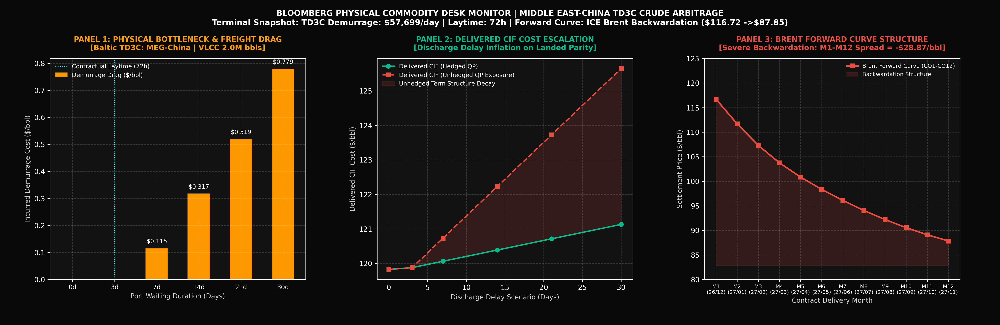

# Physical Crude Delivered Economics & Demurrage Sensitivity Prototype

[](https://www.python.org/downloads/)
[](https://opensource.org/licenses/MIT)

An independent quantitative research prototype analyzing modeled delivered-cost economics, maritime demurrage sensitivities, and illustrative term structure roll exposures for Middle East crude flowing into China (Baltic TD3C route).

The model evaluates how discharge bottlenecks, carry financing, and forward market structure distort delivered costs relative to theoretical headline spreads.



---

## 1. Baseline Assumptions & Benchmark Metadata

The model utilizes historical settlement data and charterparty conventions as fixed simulation inputs. Figures reflect representative terminal snapshots retrieved from Bloomberg Professional between October 23 and October 25, 2026:

| Parameter Category | Commercial Indicator | Contract / Field | Baseline Value | Units | Source & Nature of Data |
| :--- | :--- | :--- | :--- | :--- | :--- |
| Shipping Route | Baltic Dirty Tanker TD3C | MEG to China | 270,000 MT | Parcel Size | Standard VLCC fixture benchmark (~2.0M bbls) |
| Demurrage Rate | Model Input Parameter | Baltic Assessment Proxy | \$57,699 | USD / day | Calibrated charterparty proxy (Oct 25, 2026 snapshot)[cite: 11] |
| Contractual Laytime | Allowed Loading/Discharge | Standard SHINC Terms | 72.0 | Hours (3 days) | Free laytime post-NOR before demurrage starts |
| Crude Prompt Price | ICE Brent Futures (M1) | `COZ6 Comdty` | \$116.72 | USD / bbl | ICE Brent Dec 2026 settlement snapshot (`PX_LAST`)[cite: 13, 14] |
| Prompt Roll Spread | ICE Brent M1-M2 Spread | `COZ6 - COF7` | +\$5.02 | USD / bbl | Front-month backwardation premium snapshot[cite: 13] |
| 12-Month Curve Spread | ICE Brent M1-M12 Spread | `COZ6 - COX7` | +\$28.87 | USD / bbl | Full forward curve backwardation spread snapshot[cite: 13, 14] |
| Dubai Cash Roll | Dubai 1M vs 2M Spread | `DBL1 - DBL2` | -\$4.056 | USD / bbl | Cash market contango snapshot (Oct 23, 2026)[cite: 10] |

*Methodological & Traceability Note*: 
* This repository is an offline simulation prototype calibrated against historical Bloomberg snapshots rather than a live, automated Bloomberg API feed.
* Brent generic term structure and contract delivery schedules originate from terminal settlement queries (`CO1`-`CO12` series)[cite: 13].
* Dubai prompt roll spread reflects cash market prices queried via Bloomberg Terminal (`DBL1-DBL2` prompt spreads)[cite: 10].
* Baseline ocean freight ($2.250/bbl) and demurrage ($57,699/day) serve as model inputs for sensitivity analysis rather than live broker fixtures[cite: 11].

---

## 2. Mathematical Framework & Demurrage Mechanics

### Per-Barrel Demurrage Conversion
Under standard charterparty terms, demurrage triggers strictly after contractual laytime (72 running hours / 3.0 days) is exhausted following valid Notice of Readiness (NOR) tendering:
$$\text{Marginal Demurrage (\$/bbl/day)} = \frac{\text{Daily Demurrage Rate}}{\text{Parcel Volume}} = \frac{\$57,699}{2,000,000\text{ bbls}} \approx \$0.02885\text{ /bbl/day}$$

* Under the baseline scenario of **30 calendar days of total port waiting time following valid NOR tendering, including 3 days of allowed laytime and 27 billable demurrage days**:
  $$\text{Demurrage Drag} = 27\text{ days} \times \$0.02885\text{ /bbl/day} \approx +\$0.779\text{ /bbl}$$

---

## 3. Modular CIF Delivered-Cost Build-Up

The model evaluates a scenario combining a 21-day sea voyage with 30 calendar days of total port waiting time post-NOR (51 total working capital financing days):

* Fixed Logistics & Port Charges:
  * Baseline Ocean Freight (TD3C flat-rate proxy): +$2.250 /bbl
  * Coastal Port Dues, Pilotage & Towage: +$0.180 /bbl
* Operational Demurrage Drag:
  * Contractual Demurrage (27 billable days @ $57,699/day): +$0.779 /bbl[cite: 11]
* Financing, Loss & Cargo Administration:
  * Working Capital Cost (5.5% APR on $116.72/bbl FOB over 51 days): +$0.897 /bbl[cite: 13]
  * Documentary Letter of Credit (DLC) Issuance & Usance (0.20% flat): +$0.233 /bbl[cite: 13]
  * Contractual Ocean Loss Allowance (0.20%) & Marine Insurance (0.03%): +$0.268 /bbl[cite: 13]
  * Independent Cargo Surveyor & Laboratory Assay (SGS/Saybolt): +$0.015 /bbl

### Estimated Incremental Delivered-Cost Hurdle
$$\text{Modeled Hurdle}_{\text{Hedged}} \approx \$2.430\text{ (Freight/Port)} + \$0.779\text{ (Demurrage)} + \$1.414\text{ (Carry/Admin)} = \mathbf{+\$4.623\text{ /bbl}}$$

Under the specified assumptions, the modeled incremental delivered-cost hurdle is approximately **+$4.623 /bbl above the FOB benchmark**.

*Analytical Qualification*: This is a scenario-based cost estimate, not a complete trade-level breakeven. Actual commercial viability also depends on crude grade differentials, physical pricing formulas, destination refining netback, contractual QP terms, hedge effectiveness, and deal-specific allowances or port credits.

---

## 4. Physical Trading Realities & Model Boundaries

1. **Hedged Baseline Assumption & Roll Stress Scenarios**:
   - The baseline excludes incremental calendar-roll stress, assuming the relevant Quotation Period (QP) exposure is adequately managed. The prototype does not explicitly model hedge instruments, hedge ratios, execution prices, or residual basis risk.
   - The unhedged case applies an illustrative linear roll-stress scenario for sensitivity analysis only (M1-M2: +$5.02 /bbl)[cite: 13]. It does not represent an actual trading P&L forecast or a deterministic loss.
2. **Laytime vs. Port Congestion Realities**:
   - Port waiting time does not automatically translate to demurrage. Billable laytime is governed by charterparty terms, valid NOR tendering, weather exceptions, and berth availability.
3. **Floating Storage Economics**:
   - In steep backwardation, floating storage is generally economically unfavorable because deferred barrels trade at a discount to prompt barrels while charter and capital costs accrue.
   - However, operational storage decisions may still occur due to asset opportunity costs, contractual flexibilities, blending opportunities, or local terminal tankage constraints.

---

## 5. Project Structure & Quickstart

```text
crude-arbitrage-demurrage-monitor/
├── README.md        # Research documentation & model parameters
├── requirements.txt # Pinned environment dependencies
├── crude.py         # Simulation engine, unit tests & visualizer
└── Crude.png        # Generated 3-panel dashboard
```
Installation & Execution
```bash
# 1. Clone the repository
git clone https://github.com/Austinzhu0913/crude-arbitrage-demurrage-monitor.git(https://github.com/Austinzhu0913/crude-arbitrage-demurrage-monitor.git)
cd crude-arbitrage-demurrage-monitor

# 2. Install dependencies
pip install -r requirements.txt

# 3. Run the engine and regenerate the monitor dashboard
python crude.py
```
